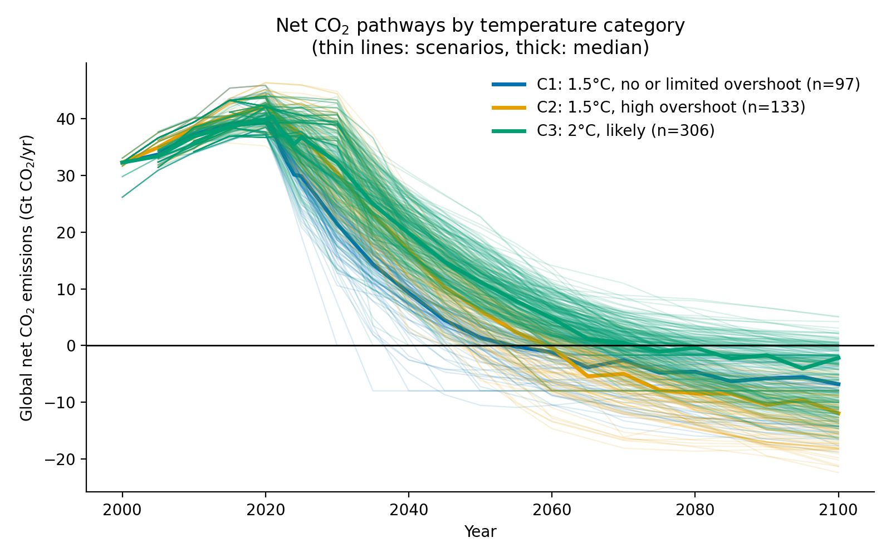
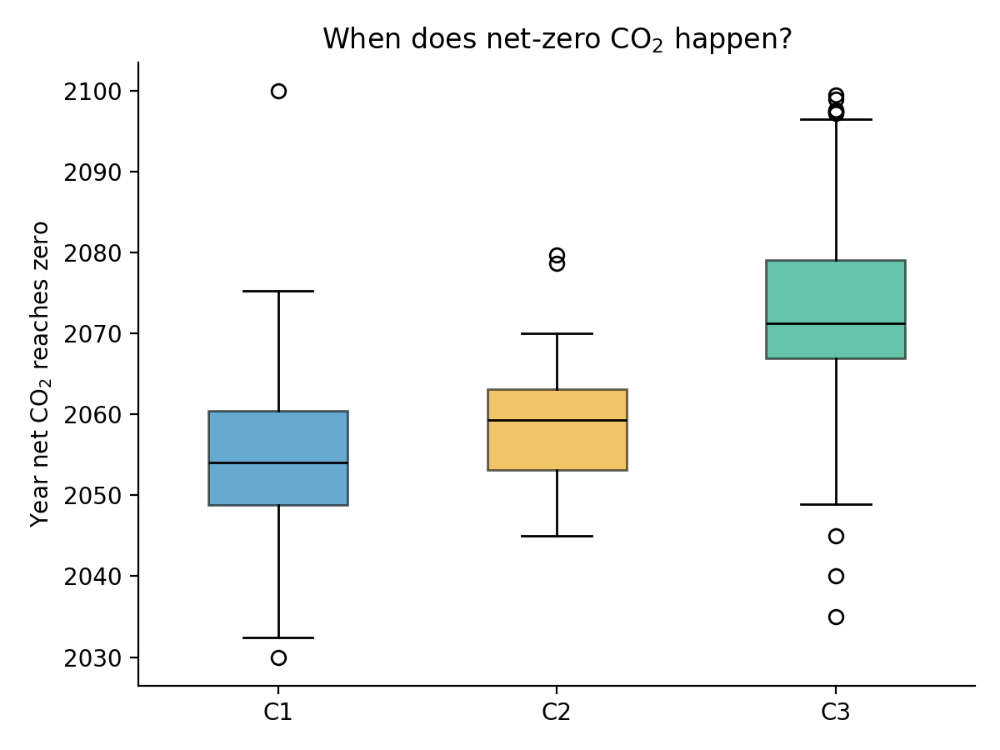

# When does net-zero CO₂ happen in IPCC AR6 scenarios?

[](https://www.python.org/downloads/)
[](https://data.ece.iiasa.ac.at/ar6/)
[](LICENSE)

## Overview

This repository provides a transparent, reproducible analysis of the timing of global
net-zero CO₂ in the mitigation scenario ensemble compiled for Working Group III (WG III)
of the IPCC Sixth Assessment Report (AR6). It retrieves the aggregate net CO₂ pathway
(`Emissions|CO2`, region `World`) for every scenario in temperature categories **C1–C3**
from the public [AR6 Scenarios Database](https://data.ece.iiasa.ac.at/ar6/) hosted by IIASA,
estimates the first year in which each pathway reaches zero by linear interpolation
between reported time steps, and compares the distribution of net-zero years across
temperature categories.

The analysis covers **536 scenarios**; the median net-zero CO₂ year is **2054** for C1
(1.5 °C, no or limited overshoot), **2059** for C2 (1.5 °C, high overshoot) and **2071**
for C3 (2 °C, likely). These figures are consistent with the headline ranges reported in
IPCC AR6 WG III (net CO₂ in the early 2050s for pathways limiting warming to 1.5 °C, and
around the early 2070s for pathways limiting warming to 2 °C).

The entire pipeline is implemented in a single, tested Python script with no manual steps
and an offline demo mode. It was motivated by the question of **residual emissions** in
deep-mitigation pathways; gross emissions and carbon dioxide removal are deliberately out
of scope for this first version.

## Contents

- [Temperature categories](#temperature-categories)
- [Results](#results)
- [Quick start](#quick-start)
- [Usage](#usage)
- [Outputs](#outputs)
- [Data and methods](#data-and-methods)
- [Project structure](#project-structure)
- [Tests](#tests)
- [Reproducibility notes](#reproducibility-notes)
- [Limitations](#limitations)
- [Future work](#future-work)
- [References and data availability](#references-and-data-availability)
- [License](#license)

## Temperature categories

Each scenario is assigned a temperature category by the database based on its projected
warming outcome; the labels are taken from the `Category` meta indicator as defined in
Annex III of IPCC AR6 WG III. This study covers the three categories corresponding to the
1.5 °C and 2 °C classes:

| Category | Meaning |
|----------|---------|
| **C1** | Limit warming to 1.5 °C (>50 % probability) with no or limited overshoot |
| **C2** | Return warming to 1.5 °C (>50 %) after a high overshoot |
| **C3** | Limit warming to 2 °C (>67 % probability) |

## Results

Statistics are regenerated from the live `ar6-public` database whenever the script is run
and may shift slightly between database releases. The figures below are from the latest
run (see [Reproducibility notes](#reproducibility-notes) for versions).

| Category | Scenarios, *n* | Reaching net zero by 2100 | Median net-zero year | Interquartile range (P25–P75) |
|----------|---------------:|--------------------------:|---------------------:|-------------------------------|
| **C1** – 1.5 °C, no/limited overshoot | 97  | 94  | **2054.1** | 2048.8 – 2060.4 |
| **C2** – 1.5 °C, high overshoot      | 133 | 133 | **2059.3** | 2053.1 – 2063.1 |
| **C3** – 2 °C, likely                | 306 | 259 | **2071.2** | 2066.9 – 2079.0 |
| **Total**                            | **536** | **486** | — | — |

Net-zero timing is systematically later for less stringent temperature goals: the median
C1 pathway crosses zero approximately **17 years before** the median C3 pathway. In total,
486 of 536 scenarios (91 %) reach net zero by 2100. The 50 scenarios that do not
(3 in C1, 47 in C3) are counted but excluded from the timing statistics.



**Figure 1.** Global net CO₂ emission pathways by temperature category. Thin lines show
individual scenarios (C1: n = 97, C2: n = 133, C3: n = 306); thick lines show the
cross-scenario median for each category. Data: AR6 Scenarios Database (Byers et al., 2022).



**Figure 2.** Distribution of the interpolated net-zero CO₂ year by temperature category.
Boxes span the interquartile range (P25–P75) with the median as a black line; whiskers
extend to the most extreme value within 1.5 × IQR and points denote outlying scenarios.

## Quick start

**Prerequisites:** Python 3.11+ and internet access for the live database query.

```bash
# 1. (Recommended) create and activate a virtual environment
python -m venv .venv
source .venv/bin/activate        # Windows: .venv\Scripts\activate

# 2. Install dependencies
pip install -r requirements.txt

# 3. Run the analysis
python ar6_netzero.py            # queries the public AR6 database and writes output/
python ar6_netzero.py --demo     # synthetic data, no internet or pyam install needed
```

The `--demo` mode generates synthetic pathways in the same data format so that the full
pipeline can be explored offline. Demo figures are watermarked
**"SYNTHETIC DEMO DATA, NOT AR6 RESULTS"** and demo files are written with a `demo_` prefix.

## Usage

```text
python ar6_netzero.py [--demo] [--out OUTPUT_DIR]
```

| Option | Description | Default |
|--------|-------------|---------|
| `--demo` | Use synthetic data instead of querying the AR6 database | off (live data) |
| `--out`  | Directory for the generated figures and tables | `output/` |

```bash
python ar6_netzero.py --out results/      # write outputs to a different directory
```

## Outputs

All files are written to `output/` (or the directory given by `--out`):

| File | Content |
|------|---------|
| `net_co2_pathways.png` | Net CO₂ pathways: thin line per scenario, thick line the median per category |
| `net_zero_timing.png`  | Boxplot of net-zero years per category |
| `net_zero_years.csv`   | Net-zero year for every individual scenario (blank if never reached) |
| `summary.csv`          | Scenario counts, number reaching net zero, and median/quartiles per category |

The two figures in `output/` are committed to the repository so that they render in the
[Results](#results) section; the CSV tables and demo files are regenerated at runtime and
are excluded from version control.

## Data and methods

### Data retrieval

Global net CO₂ emissions are queried from the public IIASA Scenario Explorer using
[pyam](https://pyam-iamc.readthedocs.io/) (Huppmann et al., 2021), which requires no
authentication for public databases:

```python
pyam.read_iiasa("ar6-public", variable="Emissions|CO2", region="World", meta=True)
```

Full category labels (e.g. `C1: limit warming to 1.5C …`) are reduced to their `C1`–`C3`
prefixes, and only these three categories are retained. Values are converted from
Mt CO₂/yr to Gt CO₂/yr.

### Net-zero crossing

For each scenario, annual time steps are sorted and the first value at or below zero is
located. The crossing year is obtained by linear interpolation between the last positive
step $(t_0, E_0)$ and the first non-positive step $(t_1, E_1)$:

$$t_{nz} = t_0 + (t_1 - t_0)\,\frac{E_0}{E_0 - E_1}, \qquad E_0 > 0 \ge E_1$$

If a series is already non-positive at the first time step, that year is returned. If a
series never reaches zero, the result is `NaN`; the scenario is counted in the category
total but excluded from the timing statistics.

### Summary statistics and visualisation

For each category, the analysis reports the number of scenarios, the number reaching net
zero by 2100, and the median, 25th and 75th percentile crossing years. Every scenario is
weighted equally. Figure 1 displays the pathway ensemble with per-category medians;
Figure 2 summarises the crossing-year distributions as boxplots with 1.5 × IQR whiskers.

The analysis covers **net CO₂ only** (`Emissions|CO2`). Gross emissions and residual
emissions cannot be derived from this single reporting variable.

## Project structure

```text
ar6-net-zero-sample/
├── ar6_netzero.py        # data retrieval, analysis, plotting and command-line interface
├── test_ar6_netzero.py   # unit tests for the analysis logic (synthetic data only)
├── requirements.txt      # pyam-iamc, pandas, numpy, matplotlib
├── output/               # generated figures (PNGs are committed) and tables (ignored)
├── LICENSE               # MIT license for the code
└── README.md
```

## Tests

The analysis logic is covered by nine unit tests that run entirely on synthetic data and
therefore require no internet connection:

```bash
python -m unittest -v
```

The tests cover the interpolation formula (mid-point, proportional and exact-zero
crossings), unsorted time steps, series that never reach zero or start already below zero,
category filtering and unit conversion, the summary statistics, and an end-to-end demo run.

## Reproducibility notes

- The live query retrieves the current `ar6-public` release from the IIASA Scenario
  Explorer; results therefore depend on the database release and on IIASA being reachable.
  The figures shown above were generated on 23 October 2026 with Python 3.14,
  `pyam-iamc` 4.0, pandas 3.0 and matplotlib 3.10.
- `requirements.txt` is unpinned; use `pip freeze` to create an exact frozen environment.
- Re-running the script overwrites files in the output directory; it never modifies the
  source data, and no write operations are performed against the database.

## Limitations

- **Net CO₂ only.** Gross emissions, carbon dioxide removal and residual emissions are not
  analysed; `Emissions|CO2` cannot be decomposed into these components.
- **Linear interpolation.** Crossing years are interpolated linearly between model time
  steps (commonly 5 or 10 years apart); the true pathway within a step need not be linear.
- **Equal weighting.** Scenarios from different models and model families are treated as
  independent, equally weighted points. Modelling groups that contribute more scenarios
  therefore have greater influence, and no reweighting or de-duplication by model family
  is performed.
- **Database classifications.** Temperature categories are taken from the database's own
  assessment; no climate emulation is re-run in this analysis.

## Future work

- Extend the analysis to categories C4–C8 and compare the computed crossing years with the
  database's `Year of netzero CO2 emissions` meta indicator.
- Examine carbon dioxide removal variables (e.g. `Carbon Sequestration|…`) and their
  implications for residual emissions.
- Break results down by model family and by shared socio-economic pathway (SSP).
- Add a model-family-balanced summary with confidence intervals.

## References and data availability

The scenario data is the **AR6 Scenarios Database**, compiled for IPCC AR6 WG III and
hosted by IIASA, and is publicly available at
[data.ece.iiasa.ac.at/ar6](https://data.ece.iiasa.ac.at/ar6/) (no authentication
required). When re-using the data, follow the database's recommended citation:

> Byers, E., Krey, V., Kriegler, E., Riahi, K., Schaeffer, R., Kikstra, J., et al. (2022).
> *AR6 Scenarios Database hosted by IIASA*. International Institute for Applied Systems
> Analysis. <https://doi.org/10.5281/zenodo.5886911>

For global mitigation pathways, also cite Chapter 3 of IPCC AR6 WG III:

> Riahi, K., Schaeffer, R., Arango, J., et al. (2022). Chapter 3: Mitigation pathways
> compatible with long-term goals. In *Climate Change 2022: Mitigation of Climate Change*.
> Cambridge University Press. <https://doi.org/10.1017/9781009157926.005>

The data access layer uses the pyam package:

> Huppmann, D., Gidden, M. J., Nicholls, Z., et al. (2021). pyam: Analysis and
> visualisation of integrated assessment and macro-energy scenarios. *Open Research
> Europe*, 1, 13. <https://doi.org/10.12688/openreseurope.13633.2>

```bibtex
@misc{byers2022ar6,
  author    = {Byers, Edward and Krey, Volker and Kriegler, Elmar and
               Riahi, Keywan and Schaeffer, Roberto and Kikstra, Jarmo and others},
  title     = {{AR6 Scenarios Database hosted by IIASA}},
  year      = {2022},
  publisher = {International Institute for Applied Systems Analysis},
  doi       = {10.5281/zenodo.5886911},
  url       = {https://data.ece.iiasa.ac.at/ar6/}
}

@article{huppmann2021pyam,
  author  = {Huppmann, Daniel and Gidden, Matthew J. and Nicholls, Zebedee and
             H{\"o}rsch, Jonas and Lamboll, Robin and Kishimoto, Paul N. and others},
  title   = {pyam: Analysis and visualisation of integrated assessment and
             macro-energy scenarios},
  journal = {Open Research Europe},
  volume  = {1},
  pages   = {13},
  year    = {2021},
  doi     = {10.12688/openreseurope.13633.2}
}
```

## License

The code in this repository is licensed under the [MIT License](LICENSE). The underlying
scenario data is © the respective modelling teams and made available by IIASA under the
terms stated on the [AR6 Scenario Explorer](https://data.ece.iiasa.ac.at/ar6/); this
license does not cover the data.
